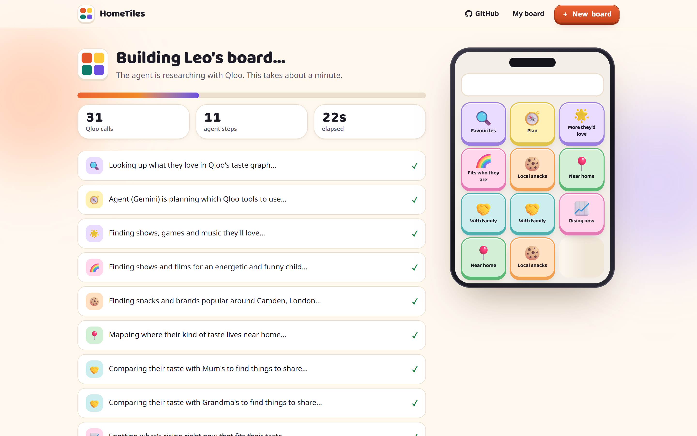
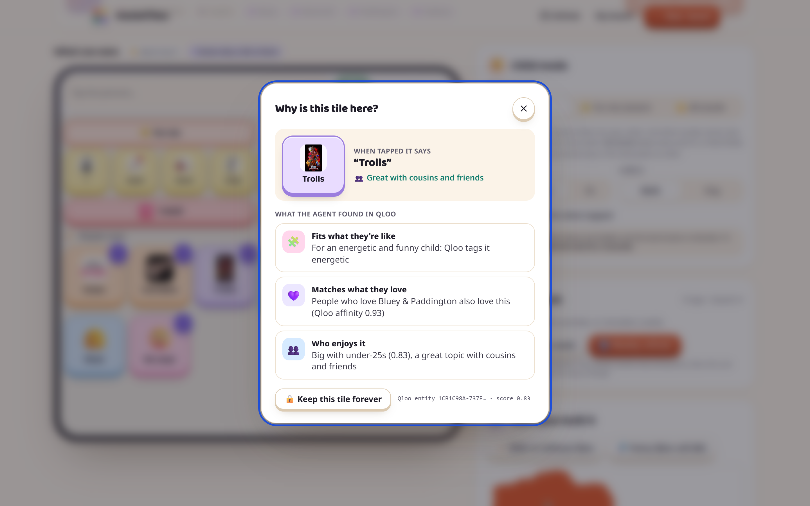
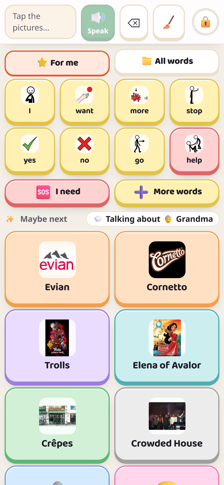

# HomeTiles: communication boards that sound like home

> *"There's more to life than cookies."* (a mother, quoted by AAC researchers Light & McNaughton, 2014)

**Live demo:** [hometiles.vercel.app](https://hometiles.vercel.app) · **Licence:** MIT · Built for the Qloo Agentic Hackathon

Non-speaking people (autistic children and adults, people with cerebral palsy, stroke survivors and others) talk by tapping picture tiles on an AAC board. Most boards are generic. A child in London can say "cookie" but not *Cadbury Buttons*, *Bluey*, or the park round the corner. A child in Delhi can't say *Parle-G*.

**HomeTiles is an agent that builds a board around one real child.** It uses Qloo's taste graph to find their real snacks, places near home, favourite shows and the things they share with their family, in their family's language. The board speaks, learns from what gets tapped on the device, and suggests weekly updates that a parent approves.

| The agent researching with Qloo | Every tile explains itself | Child mode on a phone |
|---|---|---|
|  |  |  |

More in [`docs/screenshots`](docs/screenshots).

## Try it (about a minute)
1. Open the live demo and pick **Leo** (8, Camden, London), **Aarav** (Delhi, Hindi) or **Sofía** (Los Angeles, Spanish). These are fictional children.
2. Watch the agent research the child with Qloo: each step and each Qloo call is shown live.
3. On the board, tap **?** on any tile to see the Qloo evidence behind it.
4. Press **⚖️ With vs without Qloo** to compare it with a plain-AI board.
5. Tap words in the preview: "Maybe next" adapts to what the child is talking about.
6. **▶ Give to Leo** locks the board in child mode. To exit, hold the lock for 2 seconds.

Or make a board for your own child with **＋ New board**.

## What it does
- **Agentic research with Qloo.** An LLM agent (Gemini function calling, or the Claude tool runner) chooses which Qloo tools to call. A deterministic scripted planner is the fallback.
  - `/search` resolves favourites to Qloo entities.
  - `/v2/insights` finds related shows, games, music and films, with `signal.demographics.age` and `feature.explainability`.
  - **Heatmap → places:** `urn:heatmap` shows where this taste clusters near home, then `filter.location.geohash` searches places inside those hot-spots, plus a nearby park, playground or zoo.
  - **Local snacks:** `signal.location.query`. The AI also proposes local brands, and **only the ones Qloo can find are kept** (the AI proposes, Qloo verifies).
  - **Who loves this?** `urn:demographics` routes tiles to "with cousins" or "with grandparents".
  - **Talk together:** `/v2/analysis/compare` finds what the child and a grandparent would both enjoy.
  - **What the child is like:** calm, energetic, shy… become Qloo descriptor tags (`signal.interests.tags`, union) for shows and films.
  - **What's new:** `/v2/trending` adds rising picks, with a sparkline.
- **Safe for children.** Age groups (under 8, 8–12, teen), our own screening of game ratings, adult genres, energy drinks, supplements and nightlife on top of Qloo's filters. Core, safety and family tiles are never changed automatically.
- **A tap-to-speak board.** English by default, plus Hindi and Spanish; every language comes from one registry (`src/lib/i18n.ts`). It has a sentence bar with grammar, core words in fixed places, an "I need" drawer with every safety word one tap away, jokes and reactions, and a family folder.
- **Learns on the device.** "Maybe next" uses word pairs, time of day and the live topic (talk about Grandma → the things shared with Grandma), and changes at most 3 slots at a time so the child can still find things.
- **Why this tile?** Every tile shows its Qloo evidence: affinity, distance from home, audience, trend, temperament tags.
- **Child lock.** Full-screen. Menus, the back button, typed URLs and long-press menus can't leave the board.
- **Export** to Open Board Format (`.obf`) for open AAC apps like Cboard, or print.

## Run it locally
```bash
git clone https://github.com/sosodtu/hometiles.git
cd hometiles
npm install
cp .env.example .env.local   # keys optional
npm run dev                  # http://localhost:3000
```
With **no keys** everything runs in **mock mode**: a synthetic catalogue answers the same endpoints in Qloo's response shapes. With `QLOO_API_KEY` the app calls `https://hackathon.api.qloo.com`. With `GEMINI_API_KEY` (default `gemini-3.5-flash`) or `ANTHROPIC_API_KEY`, the LLM agent, tile wording and local-snack proposals switch on.

```bash
npm test             # unit tests: ranking, safety rules, age screen, live topic, refresh API, OBF, Qloo parsers
npm run build        # production build
npx tsx --env-file=.env.local scripts/live-check.ts leo --llm   # build a demo board against live Qloo, print every folder
```

## Deploy (Vercel)
The app is one Next.js project. The pages and the backend (the API routes in `src/app/api/*`, which run as serverless functions) deploy together.
1. Import the GitHub repo at [vercel.com/new](https://vercel.com/new). The framework (Next.js) is detected automatically.
2. Under **Environment Variables** add `QLOO_API_KEY` and `GEMINI_API_KEY` (and optionally `ANTHROPIC_API_KEY`).
3. Deploy. Board generation streams progress and runs for about a minute; it's allowed up to 120 s (`maxDuration` in `src/app/api/board/route.ts`), well inside Vercel's 300 s limit.

## Architecture
See [`docs/ARCHITECTURE.md`](docs/ARCHITECTURE.md) for how it works, and [`docs/SRS.md`](docs/SRS.md) for the requirements.

```
Browser (Next.js pages)                         Server (Next.js API routes)
  wizard ─► /generate ──NDJSON stream──► /api/board ─► Agent (Gemini | Claude | scripted)
  board, child mode, predictions                        ├─ Qloo facade (live | mock, cache, rate limit, trace, fallbacks)
  (taps and sentences stay here)                        ├─ Age-aware safety screen
                                                        ├─ Board engine (ranking, quotas, protected tiles, OBF)
  weekly refresh ──anonymous IDs + counts──► /api/refresh
  "With vs without Qloo" ─────────────────► /api/baseline
  favourites as you type ─────────────────► /api/resolve
```

## Privacy and safety
- Taps, sentences and the child's name stay on the device. Qloo receives entity IDs, a city or point, and an age band. The AI never receives names.
- Demo children are fictional. HomeTiles supports speech-language therapists; it doesn't replace them, and it makes no clinical claims.
- Qloo responses are cached in server memory only and never committed (Qloo terms).

## Credits
Taste data: Qloo. Pictograms: Sergio Palao / [ARASAAC](https://arasaac.org), CC BY-NC-SA 4.0 (fetched at runtime, not redistributed). Research behind the design: Johnson et al. 2006; Moorcroft et al. 2020; Gardiner et al. 2025; Light & McNaughton 2014; Weinberg et al., CHI 2025.

Code: MIT licence (see [`LICENSE`](LICENSE)).
