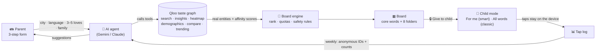
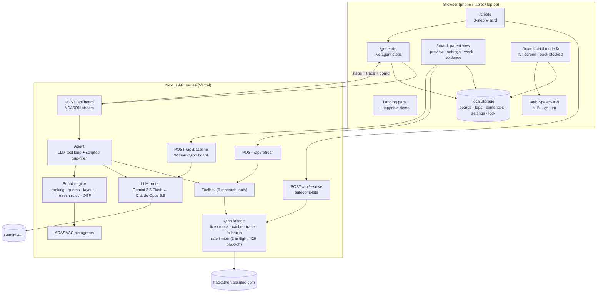
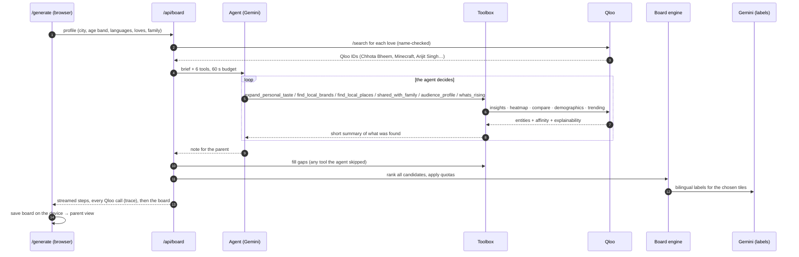
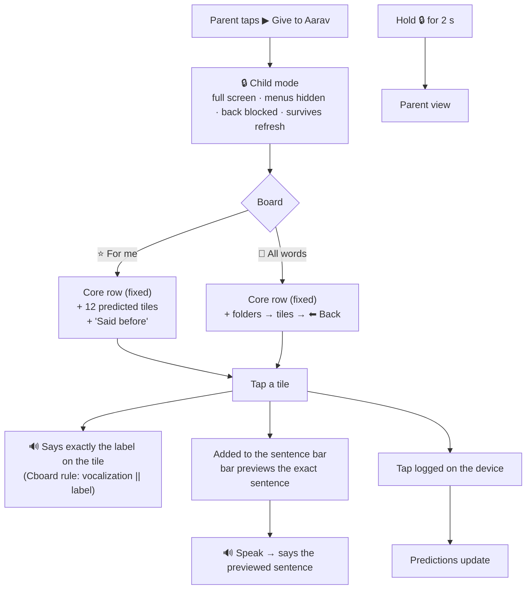
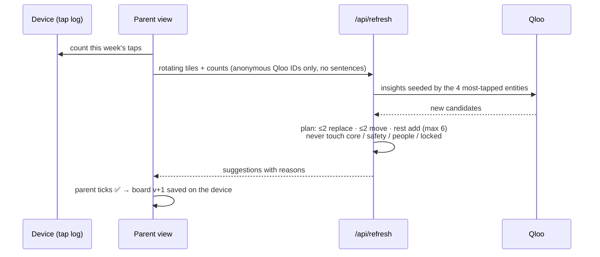

# HomeTiles: architecture and flows

How the app works end to end: where every tile comes from, what the agent does with Qloo, what the child sees, and what happens to their taps. The diagrams render on GitHub.

---

## 1. The idea in one picture



---

## 2. System architecture



**Keys stay on the server.** The browser never sees the Qloo or Gemini key. I checked the production bundle and found neither.

---

## 3. Building a board: step by step



Live run for "Aarav, Delhi": about 40 Qloo calls, about 47 s, every call visible in the **Qloo trace** panel.

---

## 4. Where every tile comes from

| Folder | Tiles | Source | Qloo call | Filters and safety | How it's chosen |
|---|---|---|---|---|---|
| ⭐ **Core** | 12 (7 + help on the smart board) | Fixed list | — | Locked; same position always | Always shown |
| 🆘 **I need** | 6 | Fixed list (help, pain, toilet, tired, scared, unwell) | — | Locked; never removed | Always shown |
| 👪 **My people** | One per family member | Parent form | — | Locked | Always shown |
| 🌟 **Favourites** | 10 | The child's loves, expanded | `/v2/insights` per type (tv_show, movie, videogame, artist), `signal.interests.entities`, `signal.demographics.age`, `feature.explainability` | Seeds matched by type (shows → shows, music → music). Children: `filter.content_rating` G/PG/TV-Y/TV-Y7/TV-G/TV-PG, artists `filter.popularity.min` 0.85, adult names/tags blocked | Score + at most 4 per kind |
| 🍲 **Food** | 8 | Snacks and drinks they'd like that are popular locally | `urn:entity:brand` + `filter.tags=…food_and_beverage`, and a city-level `signal.location.query` | Energy drinks and alcohol blocked for children | Score (local gets a boost) |
| 📍 **My places** | 6 | Real places near home | `urn:heatmap` (city) → 3 hottest cells within 2.5 km → `urn:entity:place` with `filter.location.geohash`, plus a point + radius search | Children: kid categories only (parks, ice cream, bakeries, sweet shops, playgrounds…); bars, lounges and nightclubs excluded; one branch per chain | Score; closer is better |
| 🤝 **Talk together** | 4 | Things the child and a grandparent both enjoy | `/v2/analysis/compare` → **shared tags** → `/v2/insights` with those tags + both people's favourites | Kids' content rating | Shared tags shown as the reason |
| ✨ **What's new** | up to 3 | Rising picks | `bias.trends=high`, then `/v2/trending` (data ends Sep 2025) | Games skipped (not supported) | Biggest rise; else trend-biased ranking |
| 😂 **Fun & banter** | 7 | Jokes about their top 3 favourites + 4 quick reactions | — (built from favourites) | — | Templates |

**Every Qloo tile keeps its evidence**: affinity, the favourite that drove it (explainability), distance from home, audience age group, trend. The ⓘ button shows it.

### Ranking (board engine)
```
score = 0.55 × personal affinity  +  0.25 × local fit  +  0.15 × age fit  +  0.05 × popularity
```
- *Personal affinity* is Qloo's affinity to the child's favourites.
- *Local fit* is local affinity, or how close the place is to home.
- *Age fit* comes from `urn:demographics` for the child's age band.

The engine then dedupes entities, fills each folder up to its quota, caps favourites at 4 per kind, and fills any empty favourites slots in a second pass.

---

## 5. What the child sees and hears



### What gets said (fixed in this version)
- **A tap says exactly what's on the tile.** "दादा जी" says "दादा जी", nothing more. This follows Cboard's rule (`vocalizeTile`: `tile.vocalization || tile.label`).
- **Speak says the sentence shown in the bar.** Common patterns become correct grammar, built only from the tiles shown:
  - `मैं + चाहिए + पारले-जी` → **"मुझे पारले-जी चाहिए"**
  - `चलो + Nehru Park` → **"मुझे Nehru Park जाना है"**
  - Anything else is said as the labels in order.

### How "For me" predicts (on the device, nothing sent anywhere)
```
for each tile:
  + 3 × (how often it followed the last word) + 1      ← learned word pairs (taps < 45 s apart = one sentence)
  + hint after a core word ("go" → places, "eat" → food, "want" → food / favourites)
  + 1.5 × (use at this hour)  or a small time-of-day prior (morning food, evening shows)
  + 1.0 × (use this week)
  + taste prior (the tile's board score)
then pick 12 greedily, −0.35 per repeat of the same folder (so one screen mixes food, shows, places and people)
```

---

## 6. Weekly refresh (parent approves everything)



The rules are unit-tested:
- An unused tile buried at the back is **moved to the front once** before it can be replaced.
- An unused tile already at the front is replaced.
- Locked, core, safety and people tiles are never changed.

---

## 7. Privacy: what leaves the device

| Data | Where it goes |
|---|---|
| Child's name, family names | Stay on the device (shown on tiles). Never sent to Qloo |
| City or home point (rounded to ~100 m), age band, favourites' Qloo IDs | Qloo (to find tastes and places) |
| Taps, sentences | **Stay on the device** |
| Weekly refresh | Anonymous Qloo IDs + counts only |
| The brief to the LLM | City, age band, favourite names, family relations (no names) |

---

## 8. Fallbacks (the demo never breaks)

| If… | Then… |
|---|---|
| No Qloo key | Mock mode: a synthetic catalogue with the same API shapes (amber banner) |
| No LLM key | Scripted planner + template labels |
| Gemini overloaded or slow (503 / 429 / >25 s) | Next model (3.5 Flash → 3.5 Flash-lite); the agent gets a 60 s budget, then the scripted planner fills gaps |
| Qloo 429 | Back off and retry; at most 2 requests in flight |
| Heatmap / demographics / compare / trending unavailable | Radius search / age signal / per-person scoring / `bias.trends`, noted in the trace |
| A Qloo image fails to load | The tile shows an emoji |
| Hindi voice missing on the device | Falls back to an English voice; the label stays visible |

---

## 9. Feature audit: planned vs built (as of 2026-10-30)

✅ built and checked · 🟡 partial · ❌ not built

| Area | Feature (SRS id) | Status | Notes |
|---|---|---|---|
| Intake | 3-step wizard, Qloo autocomplete, family (FR-101–104) | ✅ | Browser-tested end to end |
| Agent | LLM agent picks Qloo tools (FR-201) | ✅ | Gemini live-tested; Claude path written but untested (no key) |
| Agent | Personal expansion, local brands, places, labels, pictograms, explainability, streaming (FR-202–209) | ✅ | Live Qloo; ARASAAC for core and safety words only |
| Board | Folders, tap to speak, sentence bar, language toggle (FR-301–304) | ✅ | Tap says the label (Cboard rule) |
| Board | Edit mode (FR-305) | 🟡 | Lock/unlock per tile only; no swap/hide/reorder UI |
| Board | Offline after generation (FR-306) | ❌ | No service worker / PWA yet (board is cached locally, but the page needs the network to load) |
| Learning | Tap log, weekly refresh, parent approval, safety rules, simulate week (FR-401–405) | ✅ | Unit-tested rules |
| Qloo+ | Demographics routing (FR-501) | ✅ | Live |
| Qloo+ | Heatmap → places (FR-502) | ✅ | Needs a city-level name ("New Delhi") |
| Qloo+ | Talk together via compare (FR-503) | ✅ | Compare returns shared tags, chained into insights |
| Qloo+ | What's new via trending (FR-504) | 🟡 | Trend data ends Sep 2025 and is often flat; falls back to trend-biased ranking; games unsupported |
| Qloo+ | Interest drift (FR-505) | ❌ | Not built (P2) |
| Proof | Without-Qloo compare, Qloo trace, attribution (FR-601, 602, 605) | ✅ | Baseline generated live by Gemini |
| Export | `.obf` (FR-603) | ✅ | Single board; `.obz` (multi-board zip) ❌ |
| Export | Print board (FR-604) | ✅ | |
| Modes | Mock/live, fallbacks, `qloo:check` (FR-701–705) | ✅ | |
| Child | Lock, hold-to-exit, two boards, predictions, said-before, grammar, parent preview (FR-801–808) | ✅ | Browser-tested on phone and desktop |
| NFR | Keys server-only, zod validation, rate limit | ✅ | Bundle checked |
| NFR | Generation ≤ 25 s p50 (NFR-01) | 🟡 | About 27 s scripted, about 47 s with the Gemini agent |
| NFR | Lighthouse accessibility ≥ 95 (NFR-10) | ❓ | Not measured yet |
| Ship | Public repo + MIT | ✅ | github.com/sosodtu/hometiles |
| Ship | Vercel live demo | ❌ | Next step |
| Ship | Devpost submission | ❌ | Draft in `docs/DEVPOST.md` |
