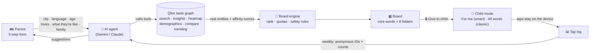
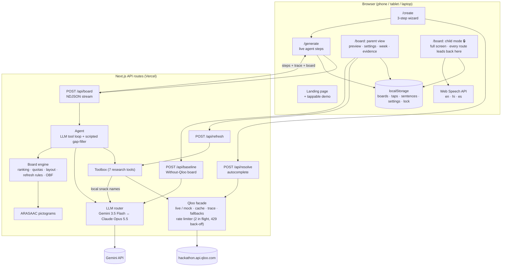
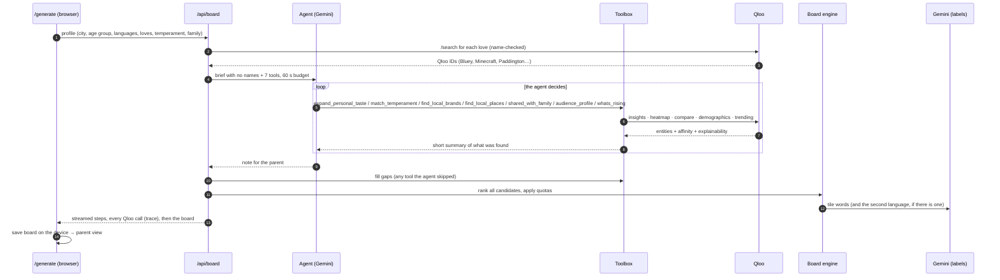
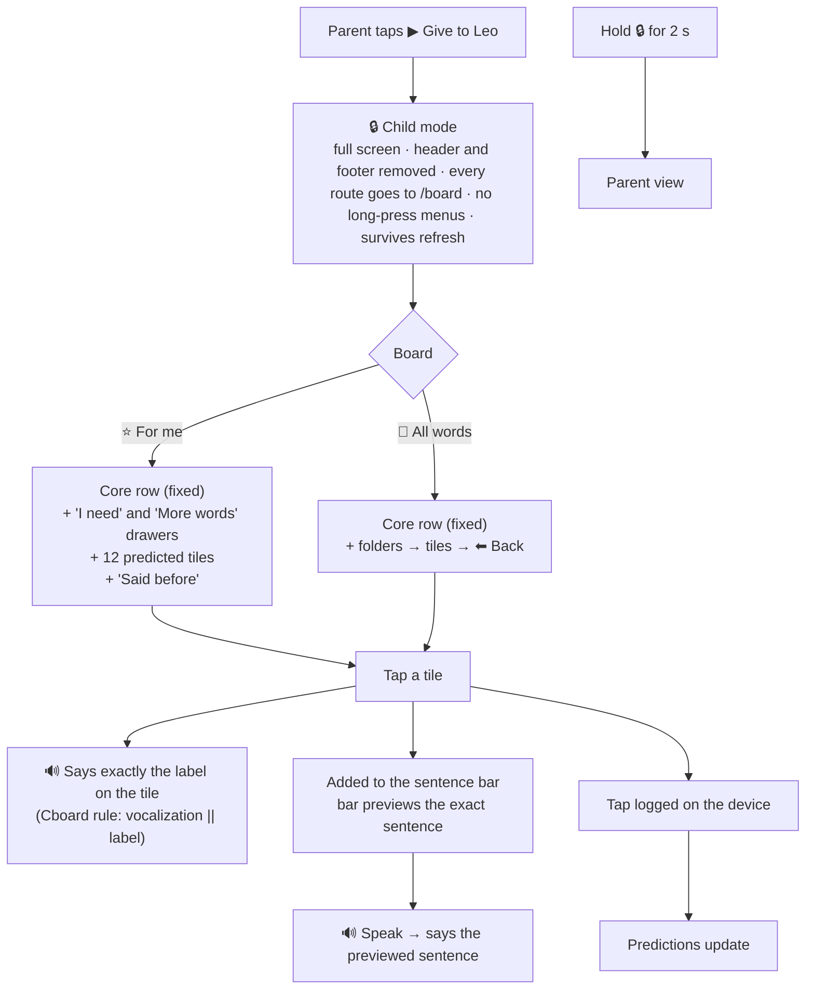
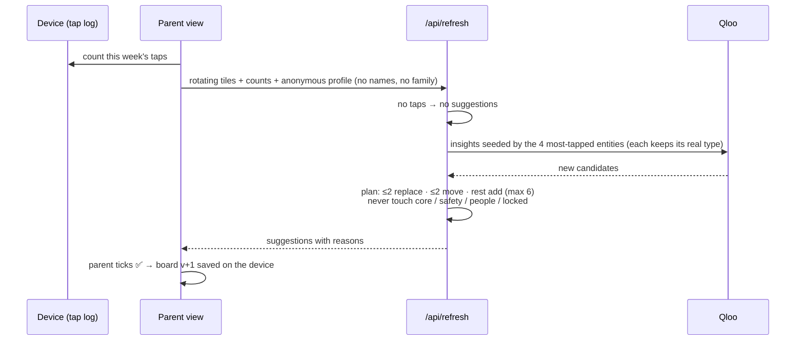

# HomeTiles: architecture and flows

How the app works end to end: where every tile comes from, what the agent does with Qloo, what the child sees, and what happens to their taps. The diagrams render on GitHub.

English is the default language. Hindi and Spanish are also supported, and the first demo child is Leo (8, Camden, London, English). Aarav (Delhi, Hindi + English) and Sofía (Boyle Heights, Los Angeles, Spanish + English) show the same board in other languages.

---

## 1. The idea in one picture



---

## 2. System architecture



**Keys stay on the server.** The browser never sees the Qloo or Gemini key. I checked the production bundle and found neither.

**Rate limits are per route and per IP** (`src/lib/http.ts`): `/api/board` and `/api/baseline` allow 4 requests a minute, `/api/refresh` 6, and everything else 30. Building a board costs dozens of Qloo and LLM calls, so it gets the lowest limit.

**Languages live in one place.** `src/lib/i18n.ts` holds every supported language (en, hi, es): its name, the name the LLM is given, and the speech voices to try. English is `DEFAULT_LANG`. Adding a language means one entry there plus its words in `board/vocab.ts` and `board/sentence.ts`.

---

## 3. Building a board: step by step



Live run for "Aarav, Delhi": about 40 Qloo calls, about 47 s, every call visible in the **Qloo trace** panel.

If the stream closes before a board arrives (time limit, dropped connection), `/generate` shows an error and a retry, instead of spinning.

To check a demo child against live Qloo from the terminal, run `npx tsx --env-file=.env.local scripts/live-check.ts leo`. It builds the board with the scripted planner and prints every folder with each tile's reasons and distance, plus any call that didn't return 200. Add `--llm` to keep the LLM steps (tile words and local snack proposals) live.

---

## 4. Where every tile comes from

| Folder | Tiles | Source | Qloo call | Filters and safety | How it's chosen |
|---|---|---|---|---|---|
| ⭐ **Core** | 12 | Fixed list | — | Locked; same position always | The smart board's core row shows 7 of them plus "help". The other 5 are in its **More words** drawer. "All words" shows all 12 in the core row |
| 🆘 **I need** | 6 | Fixed list (help, it hurts, toilet, tired, scared, not well) | — | Locked; never removed | "help" sits in the core row on both boards. On "For me" the other 5 are in the **I need** drawer under the core row; on "All words" they are a folder. Every safety word is one tap away |
| 👪 **My people** | One per family member | Parent form (if none: the word for Mom and Dad in each language) | — | Locked | Always on the board |
| 🌟 **Favourites** | 10 | The child's loves, expanded; shows and films that fit their temperament; up to 2 picks from a parent's music | `/v2/insights` per type (tv_show, movie, videogame, artist), `signal.interests.entities`, `signal.demographics.age`, `feature.explainability`. Temperament: `signal.interests.tags` with `operator.signal.interests.tags=union` | Seeds matched by type (shows → shows, music → music). Age-group content ratings and our own screen (below). Children's music: `filter.popularity.min` 0.85 and explicit rap styles excluded | Score + at most 4 per kind |
| 🍲 **Food** | 8 | Snacks and drinks they'd like that are popular locally, plus local brands the LLM suggests and Qloo confirms | `urn:entity:brand` + `filter.tags=…food_and_beverage`, a city-level `signal.location.query`, and `/search` for each LLM-proposed name | Minors: energy drinks excluded in the query (`filter.exclude.tags`) and again by our screen; coffee chains, alcohol and supplements screened out | Score (local gets a boost) |
| 📍 **My places** | 6 | Real places near home | `urn:heatmap` (city) → 3 hottest cells within 2.5 km → `urn:entity:place` with `filter.location.geohash`, plus a point + radius search. Under-13s get one more query for parks, playgrounds and zoos near home | Under-13s: kid categories only (parks, ice cream, bakeries, sweet shops, playgrounds…). Everyone: bars, lounges and nightclubs excluded; hotels and other lodging dropped; one branch per chain, the nearest | Score; closer is better. A nearby park or playground is scored mostly on closeness, since any child can use the nearest one |
| 🤝 **Talk together** | 4 | Things the child and a family member both enjoy | `/v2/analysis/compare` → **shared tags** → `/v2/insights` with those tags + both people's favourites | Age-group content rating and screen | Shared tags shown as the reason |
| ✨ **What's new** | up to 3 | Rising picks | `bias.trends=high`, then `/v2/trending` over a fixed window (below) | Games skipped (not supported). A Talk together tile stays in Talk together | Biggest rise; else trend-biased ranking |
| 😂 **Fun & banter** | 7 | Jokes about their top 3 favourites + 4 quick reactions | — (built from favourites) | — | Templates |

**Every Qloo tile keeps its evidence**: affinity, the favourite that drove it (explainability), the temperament tags it matched, distance from home, audience age group, trend. The ⓘ button shows it.

### Age groups and the safety screen
Qloo's youngest age band, `24_and_younger`, covers a 6-year-old and a 24-year-old alike. So the wizard also asks for an age group (`src/lib/board/age.ts`), and the board decides what each group may see:

| Group | Ages | TV and films (`filter.content_rating`) | Games (checked in our code) |
|---|---|---|---|
| young | under 8 | G, TV-Y, TV-Y7, TV-G | EC, E |
| child | 8–12 | adds PG, TV-PG | adds E10+ |
| teen | 13–17 | adds PG-13, TV-14 | adds T |
| adult | 18+ | no filter | no filter |

Teens count as minors. Qloo ignores `filter.content_rating` for video games, so the app only sends it for TV and films and checks each game's ESRB rating itself. A missing or unknown rating passes, because many good kids' titles have none.

Then `ageSafe` in `src/lib/agent/toolbox.ts` screens every Qloo result for a minor:
- **Names** that match adult words: bar, pub, beer, wine, casino, hookah, energy drink brands, coffee chains, diet colas, protein products.
- **What a place or brand is**, read from its category, genre and product_category tag segments (pubs, bars, alcohol, tobacco, vape shops, casinos, energy drinks, coffee and tea, vitamins and supplements, sports nutrition). It never reads "offerings" tags. On live Qloo, nearly every family restaurant in London carries wine and coffee offering tags, and reading them emptied the places folder.
- **Explicit rap tags** (mumble rap, SoundCloud rap, trap, horrorcore, drill) for under-13s.
- **A kids or family genre** for under-13s' shows and films: one genre tag segment must be family, children, kids, animation, preschool, educational or cartoon. TV-PG alone let adult romances and dramas through ("What's Wrong with Secretary Kim", "The Baker and the Beauty"), and those only carry near-misses like `family_drama`. A title with no genre tags at all passes, since there is nothing to judge.
- **The rating** Qloo reports, against the table above.

Hotels and other lodging are dropped from places for everyone. This screen exists because live testing found energy drinks offered as snacks to 8- and 9-year-olds, M-rated games, and adult sitcoms that pass as TV-PG.

### Temperament: "What is Leo like?"
The wizard asks for up to 2 of: energetic, calm, shy, curious, sporty, creative, funny (`src/lib/board/temperament.ts`). Qloo has no personality model and no child audiences; we tested for both. What it does have is descriptor tags on content, such as `urn:tag:style:qloo:calm`. Each temperament maps to a few of these tags, all checked against live Qloo.

The `match_temperament` tool sends them as `signal.interests.tags` (union), next to the child's favourites, for TV shows and films only. In testing, the tags barely changed game or music results. Sent this way the tags outweigh the favourites, so only the top 2 results per type compete at full weight; the rest are scored ×0.8. These tiles carry a "temperament" reason of the form "For an energetic and funny child: Qloo tags it …", naming the tags that matched.

### A parent's music
If a parent (mother, father, carer…) has favourite singers, one extra artist query blends them with the child's, and at most 2 new picks are kept, scored at ×0.7. The blend happens in the app because Qloo's POST weights only work within one signal group, so they can't make a parent's taste weaker than the child's. When we tried, the parent's taste took over the list.

### Local snacks: the LLM proposes, Qloo verifies
Qloo's brand results lean global (Skittles and Hershey for a child in Delhi). An LLM knows local staples but also invents and misremembers. So `proposeLocalSnacks` (`src/lib/llm/index.ts`) asks the LLM for 8 snack brands children have in that city, and `verifiedLocalSnacks` looks each one up in Qloo. A name is kept only if Qloo finds it, it carries a Qloo food tag, and it passes the age screen. The food tag matters: name search alone matched "Real" (a juice) to Real Madrid CF. On live Qloo, Delhi kept Haldiram's (Bikanervala and Amul weren't found) and London kept Ribena (Fruit Shoot and Freddo weren't found). This only runs when an LLM key is set.

### Ranking (board engine)
```
score = 0.55 × personal affinity  +  0.25 × local fit  +  0.15 × age fit  +  0.05 × popularity
```
- *Personal affinity* is Qloo's affinity to the child's favourites.
- *Local fit* is local affinity, or how close the place is to home.
- *Age fit* comes from `urn:demographics` for the child's age band.

The engine then dedupes entities, fills each folder up to its quota, caps favourites at 4 per kind, and fills any empty favourites slots in a second pass.

### Trending window
The hackathon dataset's trend history ends around September 2025, so in live mode `/v2/trending` reads a fixed window: `QLOO_TREND_START` to `QLOO_TREND_END`, default 2025-06-01 to 2025-09-30. The UI reports the number of weeks it actually got.

---

## 5. What the child sees and hears



### The child lock
- `src/components/LockGuard.tsx` runs on every page. While the lock is on, any route (a typed URL, a link, the keyboard) is sent back to `/board`.
- The site header and footer are removed from the page, not just covered (`html[data-kidlock] .site-chrome { display: none }`).
- Tiles and the hold-to-unlock button block the long-press menu ("save image", "open link").
- A lock with no board behind it (cleared storage, a deleted board) is switched off, so the device can't get stuck.
- Taps made in the parent's preview don't train the predictions. Only taps in child mode do.

### What gets said
- **A tap says exactly what's on the tile.** Leo's "Grandma" tile says "Grandma", nothing more. This follows Cboard's rule (`vocalizeTile`: `tile.vocalization || tile.label`).
- **Speak says the sentence shown in the bar.** Common patterns become correct grammar, built only from the tiles shown:
  - `I + want + Cadbury` → **"I want Cadbury"**
  - `मैं + चाहिए + पारले-जी` → **"मुझे पारले-जी चाहिए"**
  - `चलो + Nehru Park` → **"मुझे Nehru Park जाना है"**
  - Anything else is said as the labels in order.
- **Emoji are removed before speaking** (`src/lib/client/speech.ts`), so a voice never reads out "face with tears of joy".
- **With no voice for the language** on the device, the board says the tile's English text with an English voice. An English voice can't read Devanagari. The label on screen stays in the child's language.
- The Hindi and Spanish safety and reaction words are gender-neutral, for example "मुझे थकान लग रही है" and "Necesito descansar" for "tired".

### How "For me" predicts (on the device, nothing sent anywhere)
```
for each tile:
  + 3 × (how often it followed the last word) + 1      ← learned word pairs (taps < 45 s apart = one sentence)
  + hint after a core word ("go" → places, "eat" → food, "want" → food / favourites)
  + 1.5 × (use at this hour)  or a small time-of-day prior (morning food, evening shows)
  + 1.0 × (use this week)
  + taste prior (the tile's board score)
then pick 12 greedily, −0.35 per repeat of the same folder (so one screen mixes food, shows, places and people)
```

---

## 6. Weekly refresh (parent approves everything)



The rules are unit-tested:
- An unused tile buried at the back is **moved to the front once** before it can be replaced.
- An unused tile already at the front is replaced.
- Locked, core, safety and people tiles are never changed.

A separate test calls the refresh API directly: no taps gives no suggestions, and an unknown entity type is rejected.

---

## 7. Privacy: what leaves the device

| Data | Where it goes |
|---|---|
| Child's name, family names | Shown on tiles and kept on the device. They reach our server inside the profile when a board (or the Without-Qloo board) is built, are used there for tile text and the parent-facing reasons, and are not stored. **Never sent to Qloo or to the LLM** |
| Favourite names (to search), city or home point (rounded to ~100 m), age band, favourites' Qloo IDs, temperament tags | Qloo (to find tastes and places) |
| Taps, sentences | **Stay on the device** |
| Weekly refresh | An anonymous profile (name replaced with "Child", no family), the rotating tiles, and tap counts per tile. No sentences |
| The agent's brief to the LLM | City, age band and group, temperament, languages, favourite names, family relations (no names) |
| Tool results the LLM reads | Names of Qloo entities found. `shared_with_family` reports the relation ("grandmother: …"), not the person's name |
| Tile words | The chosen tiles' Qloo names and types, the languages, child or adult |
| Without-Qloo board | City, home language, child or person, favourite names |
| Local snack proposal | City and child or adult |

The wizard's name field says: "Never sent to the AI, never stored on a server."

---

## 8. Fallbacks (the demo never breaks)

| If… | Then… |
|---|---|
| No Qloo key | Mock mode: a synthetic catalogue with the same API shapes (amber banner), with Delhi, Los Angeles and London cities |
| No LLM key | Scripted planner + template labels; no LLM-proposed snacks |
| Gemini overloaded or slow (503 / 429 / >25 s) | Next model (3.5 Flash → 3.5 Flash-lite); the agent gets a 60 s budget, then the scripted planner fills gaps |
| The LLM returns an empty label | That tile keeps its template text |
| Qloo 429 | Back off and retry; at most 2 requests in flight |
| A Qloo call times out | Retried once, except heatmaps (they already get 25 s) |
| Heatmap / demographics / compare / trending unavailable | Radius search / age signal / per-person scoring / `bias.trends`, noted in the trace |
| An LLM-proposed snack isn't in Qloo | Dropped; the board's notes list which ones |
| The board stream closes early | `/generate` shows an error instead of spinning |
| The browser won't store the board (storage full, private mode) | `/generate` says so; the saved trace is capped at 250 entries to keep boards small |
| A Qloo image fails to load | The tile shows an emoji |
| No voice for the board's language on the device | Says the English text with an English voice; the label stays visible |

---

## 9. Feature audit: planned vs built (as of 2026-10-30)

✅ built and checked · 🟡 partial · ❌ not built

| Area | Feature (SRS id) | Status | Notes |
|---|---|---|---|
| Intake | 3-step wizard, Qloo autocomplete, family (FR-101–104) | ✅ | Browser-tested end to end. English default; age group and temperament added |
| Intake | Temperament (FR-105) | ✅ | Up to 2; TV and films only, via Qloo descriptor tags |
| Agent | LLM agent picks Qloo tools (FR-201) | ✅ | Gemini live-tested; Claude path written but untested (no key). 7 tools |
| Agent | Personal expansion, local brands, places, labels, pictograms, explainability, streaming (FR-202–209) | ✅ | Live Qloo; ARASAAC for core and safety words only |
| Agent | LLM proposes local snacks, Qloo verifies (FR-210) | ✅ | Live: Haldiram's kept in Delhi, Ribena in London |
| Safety | Age groups and content screen (FR-211) | ✅ | Age rules unit-tested; a mock pipeline test checks that no demo child gets energy drinks or adult places |
| Board | Folders, tap to speak, sentence bar, language toggle (FR-301–304) | ✅ | Tap says the label (Cboard rule); emoji stripped from speech |
| Board | Edit mode (FR-305) | 🟡 | Lock/unlock per tile only; no swap/hide/reorder UI |
| Board | Offline after generation (FR-306) | ❌ | No service worker / PWA yet (board is cached locally, but the page needs the network to load) |
| Learning | Tap log, weekly refresh, parent approval, safety rules, simulate week (FR-401–405) | ✅ | Unit-tested rules |
| Qloo+ | Demographics routing (FR-501) | ✅ | Live |
| Qloo+ | Heatmap → places (FR-502) | ✅ | Needs a city-level name ("New Delhi") |
| Qloo+ | Talk together via compare (FR-503) | ✅ | Compare returns shared tags, chained into insights |
| Qloo+ | What's new via trending (FR-504) | 🟡 | Trend data ends Sep 2025 and is often flat; falls back to trend-biased ranking; games unsupported |
| Qloo+ | Interest drift (FR-505) | ❌ | Not built (P2) |
| Proof | Without-Qloo compare, Qloo trace, attribution (FR-601, 602, 605) | ✅ | Baseline generated live by Gemini |
| Export | `.obf` (FR-603) | ✅ | Single board; `.obz` (multi-board zip) ❌ |
| Export | Print board (FR-604) | ✅ | |
| Modes | Mock/live, fallbacks, `qloo:check` (FR-701–705) | ✅ | Plus `scripts/live-check.ts` |
| Child | Lock, hold-to-exit, two boards, predictions, said-before, grammar, parent preview (FR-801–808) | ✅ | Browser-tested on phone and desktop |
| Child | Safety and core words one tap away on "For me" (FR-809) | ✅ | "I need" and "More words" drawers |
| NFR | Keys server-only, zod validation, per-route rate limits | ✅ | Bundle checked |
| NFR | Generation ≤ 25 s p50 (NFR-01) | 🟡 | About 27 s scripted, about 47 s with the Gemini agent |
| NFR | Lighthouse accessibility ≥ 95 (NFR-10) | ❓ | Not measured yet |
| Ship | Public repo + MIT | ✅ | github.com/sosodtu/hometiles |
| Ship | Vercel live demo | ❌ | Next step |
| Ship | Devpost submission | ❌ | Draft in `docs/DEVPOST.md` |
